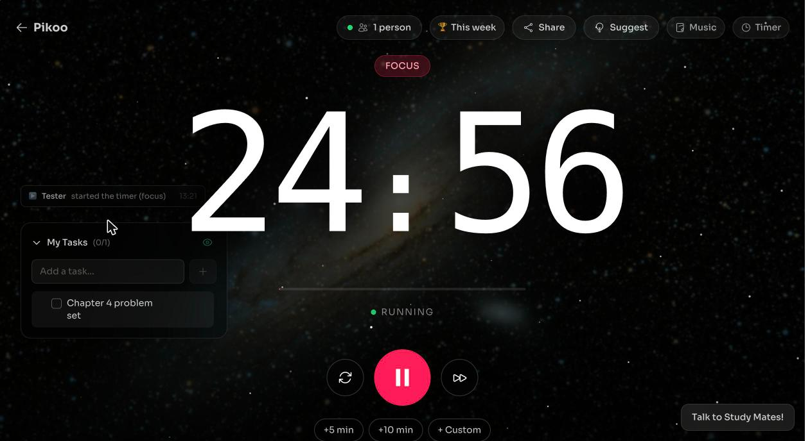
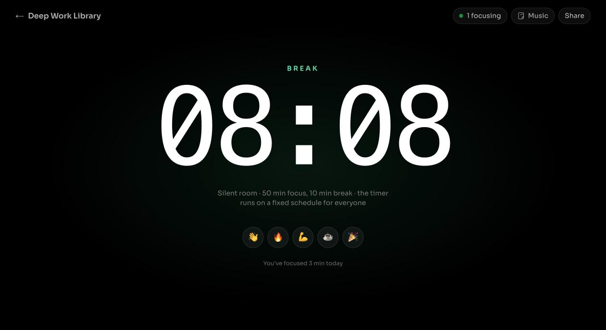
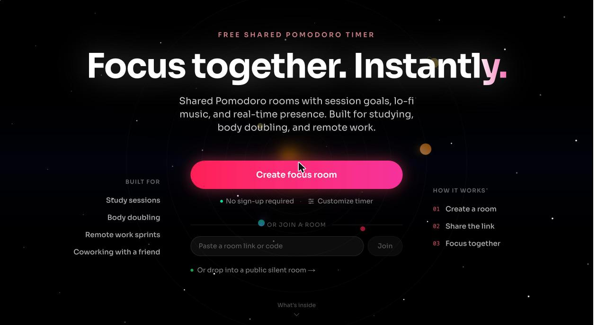

# Pikoo

**Focus together, instantly.** Pikoo is a free shared Pomodoro timer: create a room, send the link, and everyone in it runs on the same timer in real time. No accounts, no downloads, no video calls.

**[Try it → pikoo-nu.vercel.app](https://pikoo-nu.vercel.app)**



## What you can do

- **Shared rooms.** One timer for everyone in the room, synced to the server clock so nobody drifts. Start, pause, skip, or add 5, 10 or any number of minutes, and the whole room sees it instantly.
- **Your own link.** Pick a custom link like `/r/physics-group`. Rooms stay around for 30 days after they're last used, so a link pinned in a Discord or WhatsApp group keeps working.
- **Scheduled sessions.** Set a daily, weekday or weekly session time; everyone can add it to Google Calendar or download an `.ics`.
- **Weekly leaderboard.** Everyone in the room when a focus session finishes gets credited, and the week's ranking can be shared to WhatsApp.
- **Silent public rooms** at [`/library`](https://pikoo-nu.vercel.app/library). Drop in and focus with strangers. The timer runs on a fixed clock schedule and there's no chat, so there's nothing to moderate.
- **Session goals and chat.** Add tasks, share them with the room or keep them private, and talk during breaks.
- **Focus sounds.** Lo-fi, rain, café, plus white, brown and pink noise, built in.
- **Stream and Notion timer.** A view-only timer at `/embed/<room>`: add `?bg=transparent` for an OBS browser source, or paste it into Notion.
- **Solo timers** like [`/timer/25-minutes`](https://pikoo-nu.vercel.app/timer/25-minutes) and [`/timer/50-10`](https://pikoo-nu.vercel.app/timer/50-10) that start instantly and can be turned into a shared room.
- **Progress you can share.** After a session, see today's focus time and share a story-sized image.

| Silent public room | Homepage |
| --- | --- |
|  |  |

## How it works

The server never streams ticking seconds. It stores **timestamps** (`phaseEndsAt` while running, `remainingSecWhenPaused` while paused) and every client renders the countdown locally against a measured offset from the server clock. Late joiners, refreshes and sleeping laptops all land on the same second. The server ends each phase itself, so a room moves on even if everyone who started the timer has left.

```
frontend/   Next.js 16 (App Router) + React 19 + Tailwind 4 → deployed on Vercel
backend/    Express + Socket.IO + Redis (ioredis) → deployed on Railway
```

- Room state lives in Redis with a 30-day sliding TTL (in memory if `REDIS_URL` isn't set).
- Every room mutation runs under a per-room lock; inputs are sanitized and rate-limited per socket and per IP.
- Private to-dos and per-browser secrets never leave the server; each client gets a filtered view.
- Usage stats are anonymous daily counters (unique visitors via HyperLogLog, no names or IPs). Server logs trace visits under a short hashed visitor tag (pages, clicks, room actions, time spent); they never contain IPs, chat text or task text.

The original design notes are in [ARCHITECTURE.md](ARCHITECTURE.md).

## Run it locally

Requires Node.js 20 or newer.

```bash
# 1. Backend (http://localhost:3001)
cd backend
cp .env.example .env        # REDIS_URL is optional locally
npm install
npm run dev

# 2. Frontend (http://localhost:3000), in another terminal
cd frontend
cp .env.example .env.local
npm install
npm run dev
```

Open http://localhost:3000, create a room, and open the link in a second window to see the sync.

## Self-host

1. **Redis:** any Redis 6+ (Railway, Upstash, Redis Cloud, or your own).
2. **Backend:** deploy `backend/` to any Node host (Railway, Render, Fly.io, a VPS). Start command `npm start`. Set `REDIS_URL`, `FRONTEND_URL` (your site's origin), `NODE_ENV=production` and `DEBUG_SECRET`. It needs WebSocket support.
3. **Frontend:** deploy `frontend/` to Vercel (set the project's root directory to `frontend`) or any Next.js host. Set `NEXT_PUBLIC_BACKEND_URL` to the backend's URL and `NEXT_PUBLIC_SITE_URL` to your site's URL.

All variables are documented in [`backend/.env.example`](backend/.env.example) and [`frontend/.env.example`](frontend/.env.example).

## Contributing

Issues and pull requests are welcome. Suggestions can also be sent from the **Suggest** button inside any room.

## License

[MIT](LICENSE)
